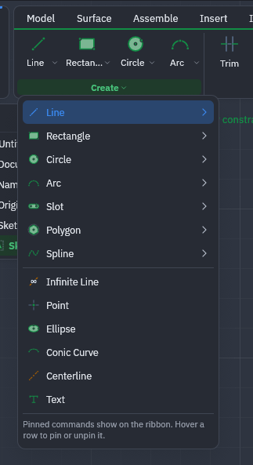
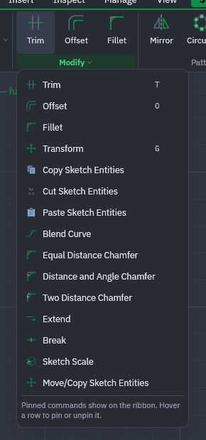
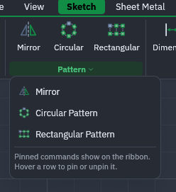
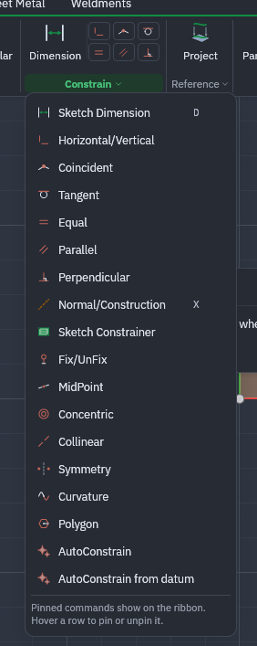
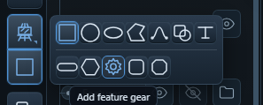
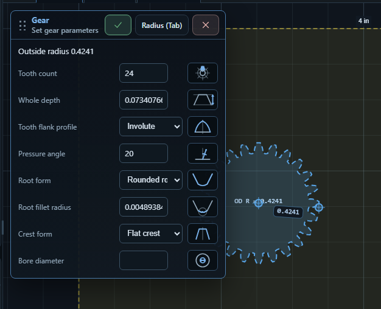
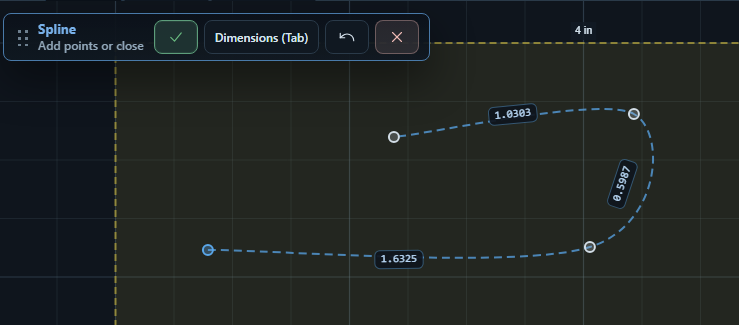

# Drawing tools and parametric CAD: inventory and proposed plan

29 October 2026. Research only; no agreed architecture or CAD rewrite.

## Why this matters

Users are creating more of their designs inside gCAM than expected. The aim is to help them draw useful parts accurately and revise them without starting again. The reference screenshots are a tool inventory and workflow reference, not a request to reproduce an entire CAD application.

## Tool inventory and gCAM comparison

“Existing” below means found in the current source, not a complete hands-on audit. “Investigate” means no equivalent was established in this focused inspection; check related code before committing to a new feature. Menu presence in a reference proves availability in that screenshot, not implementation quality.

| Reference tools | Current gCAM evidence | Proposed treatment |
| --- | --- | --- |
| Line and polyline | Both in Draw | Improve completion, numeric entry and snapping only where testing finds friction. |
| Rectangle | In Draw; opposite-corner placement | Compare centre and three-point variants; do not duplicate the existing tool. |
| Circle | In Draw; centre/radius placement and shape Properties | Compare diameter entry and three-point/tangent variants. |
| Arc | In Draw; bulge/sweep geometry helpers | Test exact radius/sweep entry and discoverability before adding variants. |
| Regular polygon | In Draw; sides and inscribed/circumscribed metadata | Existing foundation; verify later parameter editing preserves intent. |
| Freeform polygon | Polyline is related, but equivalence needs testing | Compare closing, open-path completion and last-point undo. |
| Spline | Bezier is in Draw | Compare fit-point versus control-point editing; these are different workflows. |
| Mixed line/arc/spline path | Investigate | Useful for part outlines; assess joining and editing segments before adding a tool. |
| Slot | Not exposed in the inspected Draw list | Strong candidate for a small standalone addition: end centres plus width. |
| Ellipse | Not exposed in the inspected Draw list | Candidate if actual jobs require it; preserve analytic parameters for later edits. |
| Rounded/chamfered rectangle | Rectangle plus separate Fillet/Chamfer exists | Compare editable corner size against a dedicated shape variant. |
| Gear | Not exposed in the inspected Draw list | Later specialist generator; establish demand and independently verify geometry. |
| Text | In Draw; font/text data appears in ViewLoop | Audit whether edits preserve content and font after transformations. |
| Point, infinite line, centerline | Existing guides cover some reference-line uses | Keep reference geometry separate from cutting shapes; investigate only concrete gaps. |
| Conic curve | No equivalent established | Defer unless users bring a job that needs it. |
| Trim, offset, fillet, chamfer | Existing toolbar/menu tools | Improve picking and live previews; compare chamfer variants without replacing working tools. |
| Extend, break, blend curve | No equivalent established | Investigate for repairing/joining imported or drawn outlines. |
| Transform, sketch scale, move/copy | Transform and Clone exist | Test reference-point placement and repeat-copy needs before adding overlapping commands. |
| Copy/cut/paste sketch entities | Clone is not proof of clipboard support | Check current clipboard behavior, including cross-project use. |
| Mirror | No equivalent established in inspected draw/interaction code | Candidate for symmetry without a constraint solver. |
| Rectangular/circular pattern | No equivalent established in inspected draw/interaction code | Candidate: count, spacing or angle, preview and one-step undo. Linked patterns are a later decision. |
| Align/distribute | No equivalent established in inspected draw/interaction code | Assess independently for arranging multiple selected shapes. |
| Dimensions | Live draft size inputs and shape Properties exist | Distinguish transient sizes, saved measurements and dimensions that drive edits. |
| Construction toggle | Guides exist; arbitrary construction-shape toggle not established | Research machining exclusion and persistence before extending reference geometry. |
| Constraint relationships | No sketch constraint model/solver established by this inspection | Larger project: start with a deliberately small relationship set. |
| AutoConstrain / from datum | No equivalent established | Defer until explicit constraints and conflict reporting work reliably. |

Source starting points: `src/canvas/toolbar/ToolbarCommands.tsx`, `ToolbarMenus.tsx`, `src/draw/geometry.ts`, `src/components/CadInspector.tsx`, `src/interactions/useCadInspector.ts`, and `src/canvas/types.ts`.

## Proposed plan — not approved implementation scope

### 1. Establish the current drawing baseline

Use a small mounting plate with two holes and one adjustment slot. Record creating, sizing, selecting and revising it, including touch input. Compare the same actions in the references. Produce a short gap list with screenshots, distinguishing missing functions from functions that are hard to find.

Check the existing circle, rectangle, arc, polygon, Bezier, text, Transform, Clone and Properties flows. Check exact inputs, snapping, Esc, last-point undo and open/closed completion. Guides already exist and are not a new drawing-tool proposal.

### 2. Pick small drawing improvements independently

Suggested first shortlist: slot; mirror; rectangular/circular repeat; and clearer direct size editing. Confirm their value using real jobs before choosing order. Keep each a separate change with its own preview, cancel, undo, saved-project round trip and generated-path checks.

A slot milestone would let a user pick two end centres, enter width, place the preview and later change width/length without redrawing. A pattern milestone would let them preview count/spacing and commit all copies in one undo step. Neither needs a general constraint solver.

### 3. Preserve editable shape intent

Before claiming parametric editing, audit where current commands preserve or discard `sourceType`, radius, sides, text and curve data. `ViewLoop` currently exposes sampled points plus selected metadata; this alone is not a constrained sketch model.

Choose one simple shape family for a spike. Save its definition, regenerate its displayed/cutting outline after a parameter edit, and preserve stable identity where practical. Decide explicitly what Trim, Combine/Subtract and non-uniform scaling do to the editable definition. Show conversion to a plain outline when that is necessary rather than silently promising editability.

Acceptance: save/reopen retains inputs; edit/undo/redo restores both inputs and geometry; existing projects still load; affected toolpaths become stale and regenerate correctly. Do not change all geometry storage at once.

### 4. Investigate driving dimensions and constraints

Use a rectangle with two equal holes. Proposed first relationships: horizontal/vertical, coincident, equal, and a size or distance. Demonstrate changing plate width while maintaining hole equality and intended edge distances.

Research the geometry representation, stable references, solver options and licensing, numeric tolerance, units, conflict reporting and what remains free to move. Compare with SolidCraft and PureCut using the same task; do not assume that every displayed dimension is a driving constraint.

Acceptance: clear under/constrained/conflicting feedback; impossible edits leave the last valid shape intact; undo restores relationships; deleted references are explained; save/reopen and toolpath regeneration work. Stop for a design decision after the spike before any broad migration.

### 5. Expand only after the basic model works

Later candidates: parallel/perpendicular, tangent, concentric, collinear, midpoint, symmetry and fix/unfix. Curvature, conics, linked patterns, automatic constraints, gears and a full feature-history system remain separate scope decisions.

## Next research deliverables

- A completed hands-on comparison of the mounting-plate job, with the actual clicks and edit failures recorded.
- A ranked shortlist of drawing improvements, tied to user examples and current gCAM gaps.
- A small editable-shape experiment and a separate constraint experiment, each with a go/no-go recommendation.
- A record of data-format and toolpath-reference implications before selecting a solver or architecture.

## Existing guides — not a new task

gCAM already exposes Draw → Guide in `src/canvas/toolbar/ToolbarCommands.tsx`. Placement and deletion live in `src/interactions/useGuideCommands.ts`; edge/axis picking and offset placement live in `src/canvas/pointer/guides.ts` and `src/lib/guides.ts`. CAMCANVAS is a reference for this existing workflow, not a proposed port.

The research focus is parametric editing and drawing tools. User testing shows people using the internal drawing tools more than expected, so creating and revising a complete design inside gCAM deserves attention.

## Parametric CAD references

### PureCutCNC

[App](https://purecutcnc.github.io/app/) · [Measure and dimensions](https://purecutcnc.github.io/guide/sketch-dimensions.html)

The retrieved guide distinguishes temporary tape measurements from saved, anchored dimensions. Dimensions follow referenced geometry and stay out of machining/export. References include vertices, midpoints, centres, stock and origin. Most dimensions are annotations, but the guide also documents drive-capable dimensions: editing an unambiguous size reshapes its feature, with a choice of which side stays fixed. Ambiguous dimensions remain measurements. This is distinct from proving a general constraint solver.

Gather next: dimension editing, any driving constraints, shape property editing, broken-reference handling, project representation and how changes invalidate toolpaths.

### SolidCraft

[App](https://solidcraft.io/app) · [Sketching and constraints](https://docs.solidcraft.io/guide/sketching.html) · [Parameters and expressions](https://docs.solidcraft.io/guide/parameters.html)

The official documentation describes constrained sketches, construction geometry, named parameters, unit-aware expressions and dependent dimensions. Parameter changes rebuild dependent features. It documents checks for incompatible units and parameter cycles. These are documented behaviors, not workflows tested in the running app during this pass.

Gather next: under/fully/over-constrained feedback, editing a dimension without losing intent, stable references, failure recovery and undo behavior. Review source and licensing before considering code reuse.

## Possible first investigation

Use a small 2D plate with a rectangular outline and two equal holes. Change width and hole diameter, preserve symmetry and edge distances, save/reopen, undo, and regenerate its toolpaths. Compare both references against this same job before choosing an approach.

Keep editable shape properties, measurement annotations, construction guides and driving constraints distinct. A full solid-modeling feature timeline is a separate, much larger decision.

## Drawing workflows to study next

[PureCut drawing tools](https://purecutcnc.github.io/guide/sketch-tools.html) · [Editing features](https://purecutcnc.github.io/guide/sketch-edit.html)

Documented reference ideas:
- Exact size entry while placing a shape, instead of drawing roughly and correcting afterward.
- Slots, ellipses, rounded/chamfered rectangles and editable gear profiles.
- A composite path that switches between line, arc and spline segments while drawing.
- Editable text and shape properties after placement.
- Copy placement using source/destination points with snapping, plus repeated copies.
- Alignment and distribution for multiple selected shapes.

These are candidates to compare with current gCAM behavior, not a list of confirmed omissions. gCAM already has lines, rectangles, polygons, circles, arcs, Bezier curves, polylines, text, Mandala, Transform and guides. Review shape Properties and existing copy/arrange behavior before declaring gaps.

Proposed research order:
1. Follow one small job from drawing through export and note where users must redraw or leave gCAM.
2. Compare exact-size placement, useful shape variants and repeat/align workflows; identify small independent improvements.
3. Study editable dimensions and shape references using the plate-and-two-holes example above.
4. Assess constraints, named parameters and dependent geometry as the larger project, including undo, persistence and toolpath regeneration.

Capture screenshots and short interaction sequences in a later hands-on pass. Current findings come from the official documentation and local source inspection; no CAD engine or solver choice has been made.

## User-supplied visual references — 29 October 2026

Seven screenshots are saved in `parametric-cad-references/`. The first four show a sketch ribbon with Create, Modify, Pattern and Constrain groups; the last three show a compact shape picker and on-canvas gear/spline workflows. These observations come from the supplied images. A visible command is not evidence that its implementation, solver or file format is suitable for reuse.

### Create: tool families without a crowded toolbar

Visible families: line, rectangle, circle, arc, slot, polygon and spline. Other commands include infinite line, point, ellipse, conic curve, centerline and text. Submenus allow variants within a family; selected commands can be pinned to the ribbon.

Research questions: which variants help actual gCAM jobs, and which can share one button? Keep reference-only infinite lines/centerlines distinct from shapes that generate toolpaths. Avoid adding the entire menu just for parity.

### Modify: precise edits to existing geometry

Visible tools include trim, offset, fillet, transform, sketch clipboard actions, blend curve, extend, break, sketch scale and move/copy. Chamfer variants include equal distance, distance-and-angle, and two distances.

Study how the tool asks for geometry and values, previews the result, and recovers from invalid selections. Compare the workflows with gCAM's existing tools before treating any command as missing.

### Pattern: repeated geometry

Mirror, circular pattern and rectangular pattern form a separate group. Investigate count, spacing/angle, centre/axis selection and live previews. Separately decide whether copies remain linked when the source changes; the screenshot does not establish that behavior.

### Constraints: the larger parametric project

Visible commands: sketch dimension, horizontal/vertical, coincident, tangent, equal, parallel, perpendicular, construction toggle, sketch constrainer, fix/unfix, midpoint, concentric, collinear, symmetry, curvature, polygon, AutoConstrain and AutoConstrain from datum.

For research, start with dimensions, coincident, horizontal/vertical and equal relationships on the plate-and-two-holes example. Evaluate selection feedback, remaining movement, conflicting rules and undo. Tangency, curvature and automatic constraints can be assessed later. This is a proposed investigation sequence, not an approved implementation scope.

### Compact picker and editable generated shapes

The two-row picker exposes multiple drawing tools in little space and identifies the gear command on hover. Research recognisable icons, readable tooltips and touch access before adopting an icon-heavy layout.

The gear panel shows outside radius, tooth count, whole depth, tooth flank profile, pressure angle, root form, root fillet radius, crest form and bore diameter. Small diagrams accompany parameters; a canvas preview and radius input remain visible beside the panel. Confirm/cancel controls sit in its header.

Study this as an example of an editable generated shape: preserve the input parameters, preview changes, validate combinations and allow later edits. The screenshot alone does not verify gear accuracy or establish a requirement to implement gears.

### Spline: drawing with feedback on the canvas

The screenshot shows an in-progress dashed curve, point markers, dimension labels and a small floating workflow bar with confirm, Dimensions (Tab), undo and cancel. The prompt says “Add points or close”.

Compare fit-point and control-point workflows, open/closed completion, removing the last point, exact dimensions and editing afterward. Capture whether labels are measurements or driving inputs rather than assuming all displayed dimensions constrain the curve.

### Findings to carry into the next review

- Keep related tool variants together, with the common choice easy to reach.
- Keep the drawing visible while values change; use clear preview/confirm/cancel behavior.
- Separate useful new drawing tools from the larger constraints/parameters system.
- Preserve editability and toolpath references when a shape changes.
- Use the supplied screenshots as research references; no new tools are implemented by this note.
